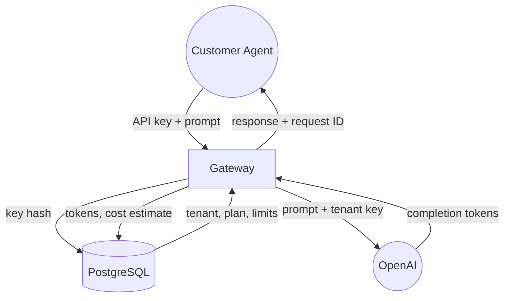
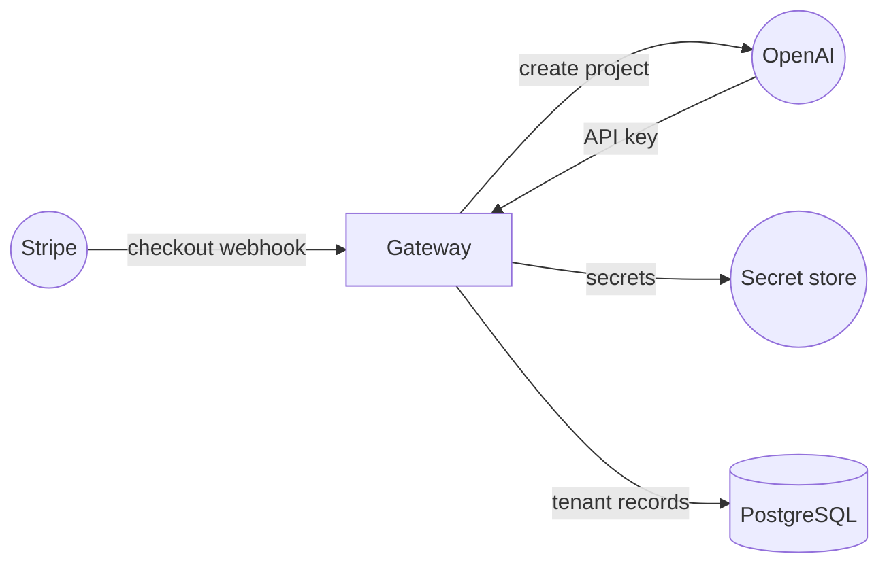
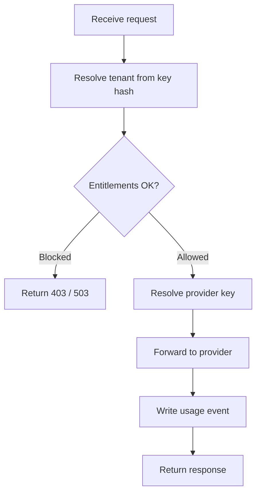

# Mermaid Diagrams

## The Rule

**Never use UML sequence diagrams** (`sequenceDiagram`). They are hard to read — vertical lifelines, dashed arrows, self-referencing loops, and `alt` fragments make them visually noisy and unintuitive. Do not use them.

Use these diagram types instead:

### Data Flow Diagram (preferred for system interactions)

Use when showing **how data moves between services** — API calls, credential flows, request/response patterns, provisioning pipelines.



**Shape conventions:**
- `(("name"))` — external entity (double circle)
- `["name"]` — process / service (rectangle)
- `[("name")]` — data store (cylinder)
- Edge labels describe **what data** moves, not implementation detail

**Why this works:** You see every system, every data payload, and every connection at a glance. No temporal axis to trace, no lifeline confusion.

## Layout Rules (preventing label overlap)

Mermaid's default spacing causes edge labels to overlap on diagrams with many connections. Always apply these rules:

### 1. Always set spacing config

Every diagram with more than 3 edges must include an init directive:

```
%%{init: {"flowchart": {"nodeSpacing": 80, "rankSpacing": 60}} }%%
```

Increase values further for dense diagrams (5+ edges: use 100/80).

### 2. Use LR for fan-out patterns

When one node connects to 3+ other nodes, use `flowchart LR` (left-to-right). The horizontal spread gives labels room. Reserve `TB`/`TD` for simple linear flows or shallow trees.

### 3. Keep edge labels short

Labels describe **what data** moves in 2-4 words. Long labels cause overlap regardless of spacing.

| Bad | Good |
|-----|------|
| `"checkout.session.completed webhook event"` | `"checkout webhook"` |
| `"on failure: rollback DB, delete secret, archive project"` | `"rollback"` |
| `"tenant + subscription + credential records"` | `"tenant + credentials"` |

If detail matters, put it in prose below the diagram, not in the label.

### 4. Define nodes inline on first use

Instead of declaring all nodes up front then connecting them, define each node inline where it first appears. This gives the layout engine better hints:



### 5. Separate happy and failure paths visually

Use solid arrows (`-->`) for happy path and dashed arrows (`-.->`) for failure/rollback. Keep failure labels ultra-short (`"rollback"`, `"delete"`, `"archive"`).

### Flowchart (for decision logic and process steps)

Use when showing **branching logic, decision points, or step-by-step processes** — entitlement checks, provisioning workflows, error handling paths.



**Shape conventions:**
- `[text]` — action step (rectangle)
- `{text}` — decision point (diamond)
- `-- label -->` — labeled edges for branches

### When to use which

| Scenario | Diagram type |
|----------|-------------|
| What data flows between services | Data Flow Diagram (`flowchart TB`) |
| Multi-service request lifecycle | Data Flow Diagram |
| Credential / secret resolution chain | Data Flow Diagram |
| Provisioning or deprovisioning pipeline | Data Flow Diagram |
| Decision logic with branching | Flowchart (`flowchart TD`) |
| Step-by-step process with conditionals | Flowchart |
| Deployment topology / network shape | `graph LR` or `graph TD` (these are fine) |

### What to avoid

- `sequenceDiagram` — banned. Convert to data flow diagram.
- `participant` / lifeline syntax — this is sequence diagram syntax, do not use.
- `alt` / `opt` / `loop` combined fragments — use flowchart diamonds instead.
- Self-referencing arrows (entity calling itself) — break into explicit steps or omit.

### Converting a sequence diagram to data flow

When you encounter an existing `sequenceDiagram` block:

1. List every participant — these become nodes.
2. List every message — these become labeled edges showing **what data** moves.
3. Collapse redundant back-and-forth into a single bidirectional description if clearer.
4. Use `flowchart TB` (top-to-bottom) for data flow, `flowchart TD` for process flow.
5. External entities get `(("name"))`, services get `["name"]`, data stores get `[("name")]`.
